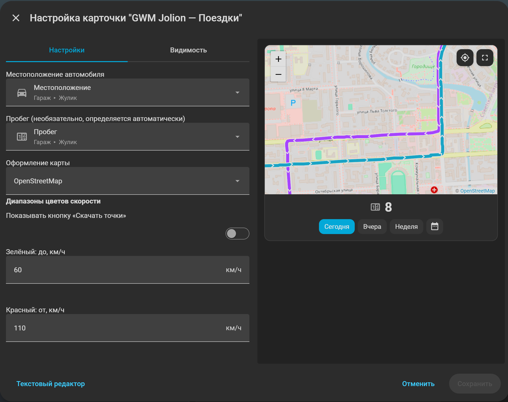
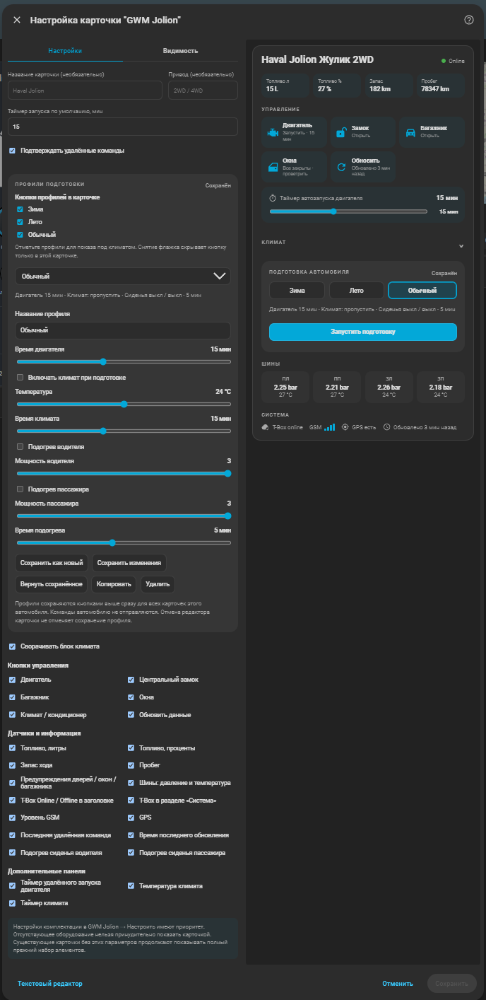
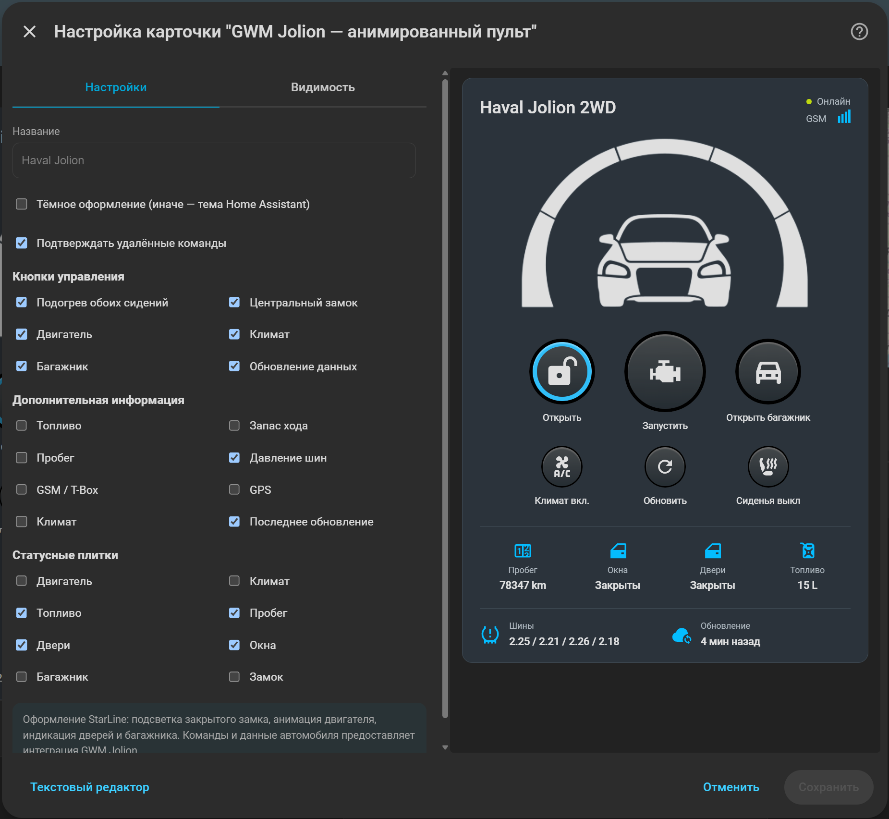

<p align="center"></p>

# GWM Jolion для Home Assistant

Состояние автомобиля, удалённое управление и история поездок **Haval Jolion с российским GWM Cloud**. Неофициальная интеграция, разработанная на Haval Jolion 2022 Premium.

**Стабильная версия 0.2.6** · [Скачать релиз](https://github.com/IndeecDen/ha-gwm-jolion/releases/latest) · [Что изменилось](CHANGELOG.md#026) · [Установить Jolion Locator](docs/golion-locator.md)

## Возможности

- **Состояние:** двигатель, замок, двери, окна, багажник, климат и связь с автомобилем.
- **Показания:** топливо, запас хода, пробег, давление и температура шин, предупреждения TPMS для каждого колеса.
- **Управление:** запуск и остановка двигателя, замок, багажник, световой и звуковой сигналы, закрытие окон и проветривание.
- **Комфорт:** температура и время работы климата, подогрев передних сидений с уровнями 0–3 и таймером 1–10 минут.
- **Подготовка одной кнопкой:** собственные профили двигателя, климата и подогревов; запуск из карточки или автоматизации.
- **Поездки:** карта маршрутов, стоянки, направление движения, скорость и пробег за выбранный период.
- **Jolion Locator для Android:** более подробный GPS-трек с ГУ или телефона, запись без интернета, передача напрямую в HA или через Яндекс.Диск.

Locator необязателен: без приложения карта использует координаты облака GWM. Доступные команды зависят от комплектации; данные облака могут приходить с задержкой. Частый опрос HA не заставляет автомобиль чаще отправлять координаты.

## Установка интеграции

Требуется **Home Assistant 2026.7 или новее** и учётная запись российского приложения GWM.

1. Откройте HACS → меню → **Пользовательские репозитории**.
2. Добавьте `https://github.com/IndeecDen/ha-gwm-jolion`, категория **Интеграция**.
3. Найдите **GWM Jolion**, установите и перезапустите Home Assistant.
4. В **Настройки → Устройства и службы → Добавить интеграцию** выберите **GWM Jolion**.
5. Введите телефон и пароль аккаунта GWM. Для команд автомобилю разрешите удалённое управление и укажите PIN безопасности.
6. Добавьте нужные карточки на панель. Их ресурсы подключаются автоматически; при нескольких автомобилях выберите устройство в редакторе.

Для ручной установки скачайте `ha-gwm-jolion-0.2.6.zip` из [релиза](https://github.com/IndeecDen/ha-gwm-jolion/releases/tag/0.2.6), распакуйте папку `custom_components/gwm_jolion` в каталог конфигурации HA и перезапустите HA.

## Карточки

### Поездки

<p align="center"></p>

```yaml
type: custom:gwm-jolion-trips-card
entity: device_tracker.YOUR_CAR
```

Замените `device_tracker.YOUR_CAR` сущностью местоположения вашего автомобиля либо выберите её в визуальном редакторе.

- **Сегодня, вчера, неделя или календарный период.** Под картой — пробег за выбранный период.
- **Общий вид:** поездки между стоянками выделены разными цветами, стрелки показывают направление.
- **Нажатие на линию:** открывает поездку отдельно и раскрашивает её по скорости. Наведение показывает среднюю скорость конкретного отрезка; отсутствие скорости обозначается отдельно.
- **«← Весь трек»** возвращает общий вид. На компьютере также работает Esc.
- **Стоянки A, B, C…:** в подсказках — начало, окончание и длительность. Короткая остановка на светофоре не должна становиться отдельной поездкой.
- **Пропуски GPS:** участки записи остаются раздельными. В выбранной поездке границы пропуска отмечены небольшими кружками с пояснением; прямая линия через неизвестный путь не рисуется.
- **Оформление:** Positron, Dark, Liberty или OpenStreetMap; отдельный API-ключ не нужен.
- **Полный экран:** кнопка в правом верхнем углу разворачивает карту; **«✕ Закрыть карту»** позволяет выйти и на телефоне.
- **«Скачать точки»:** экспорт данных выбранного периода для разбора маршрута. Кнопку можно скрыть в редакторе или через `show_download_points: false`.
- **«Скачать GPX»:** экспорт маршрута за выбранный на карте период для просмотра в других приложениях. Кнопка по умолчанию выключена; включите **«Показывать кнопку «Скачать GPX»»** в редакторе или задайте `show_download_gpx: true`. Экспортируется весь выбранный период, даже при просмотре отдельной поездки. Разрывы GPS сохраняются отдельными сегментами, время точек — если оно известно. Без координат кнопка неактивна.

В редакторе также доступны сущность пробега и границы зелёного/красного диапазонов скорости. История хранится 90 дней по умолчанию; срок меняется в настройках интеграции. Точность маршрута зависит от исходных GPS-данных.

### Управление автомобилем

<p align="center"></p>

```yaml
type: custom:gwm-jolion-card
```

Карточка объединяет состояние, команды, климат, подогревы и шины. Для сидений выберите уровень и таймер, затем нажмите **«Применить»**. Знак «?» у показания означает, что оно недоступно. Предупреждение TPMS приходит от автомобиля, а не вычисляется по порогу давления карточки.

В редакторе можно включить **«Сворачивать блок климата»**. Профили подготовки при этом остаются доступными.

### Пульт

<p align="center"></p>

```yaml
type: custom:gwm-jolion-remote-card
```

Компактная карточка с автоматической светлой/тёмной темой и настраиваемыми кнопками. Кнопка **«Подогрев обоих сидений»** включает уровень 3 на 10 минут; повторное нажатие выключает подогрев.

## Профили подготовки и автоматизации

1. Откройте редактор основной карточки → **Профили подготовки**.
2. Выберите шаблон «Зима», «Лето», «Только водитель» или создайте свой профиль.
3. Задайте температуру, время двигателя и климата, сиденья и подогревы. Нажмите **«Сохранить как новый»** или **«Сохранить изменения»**.
4. В карточке выберите профиль и нажмите **«Запустить подготовку»**.

До 20 профилей на автомобиль, копирование, переименование и выбор видимых кнопок. Настройки сохраняются в HA и доступны на всех устройствах. Изменённые, но не сохранённые параметры помечаются **«Изменён»**; **«Вернуть сохранённое»** отменяет их. Само редактирование не отправляет команды.

Двигатель, климат и сиденья запускаются последовательно. Если этап завершился ошибкой, дальнейшие команды прекращаются. Оборудование, отключённое в настройках комплектации, пропускается.

В автоматизации используйте **«Кнопка → Нажать»** и сущность **«Запустить профиль: Зима»** или другого профиля. **«Запустить выбранный профиль»** использует текущий выбор и параметры карточки. Для отдельного управления сиденьями доступно действие `gwm_jolion.set_seat_heating` (`driver`/`passenger`: 0–3, `operation_time`: минуты).

## GPS с головного устройства: Jolion Locator

Приложение работает на **Android 8.1 и новее**, записывает GPS в фоне и сохраняет очередь при отсутствии сети. На главном экране — состояние записи, спутники, точность, очередь и последняя передача. Настройки и диагностика вынесены в отдельные разделы, кнопки записи закреплены внизу.

| Подключение | Что необходимо | Инструкция |
|---|---|---|
| **Напрямую HTTPS → HA** | HTTPS-адрес HA, доступный из сети автомобиля | [Установка, ID/ключ и QR](docs/golion-locator.md#прямое-подключение-по-https) |
| **Через Яндекс.Диск** | Аккаунт Яндекса, OAuth-токен для приложения и публичная папка | [Получение токена и настройка обеих сторон](docs/golion-locator-yandex.md) |

**[Скачать Jolion Locator 0.2.0.apk](https://github.com/IndeecDen/ha-gwm-jolion/releases/download/0.2.0/Jolion.Locator.0.2.0.apk)**

Внешний доступ к HA для режима Диска не требуется: HA сам забирает файлы. Облачные команды автомобилю в обоих случаях выполняются через GWM.

## Настройки интеграции

В **Настройки → Устройства и службы → GWM Jolion → Настроить** доступны интервалы GPS и других данных, удалённое управление/PIN, пауза команд, комплектация сидений, хранение поездок и подключение Locator. Для Диска дополнительно задаются публичная ссылка, интервал опроса и необязательная автоочистка.

## Обновление

- **Интеграция:** обновите через HACS, перезапустите HA и обновите страницу панели.
- **Приложение:** откройте **Диагностика → Проверить обновления**. Locator найдёт новую версию в GitHub Releases, загрузит APK и предложит системную установку. Обновление устанавливается поверх приложения с сохранением настроек и очереди. Если в старой версии такой кнопки нет, скачайте APK из релиза вручную.
- Для обновлений на ГУ должен быть доступен GitHub. Android может запросить разрешение установки из Jolion Locator; после разрешения вернитесь в приложение.

[Подключение и решение проблем Locator](docs/golion-locator.md) · [Диагностика](docs/diagnostics.md) · [Полный список изменений](CHANGELOG.md)

## Лицензии и благодарности

Интеграция — [MIT](LICENSE). Оформление пульта основано на [StarLine Card](https://github.com/Anonym-tsk/lovelace-starline-card), [GPL-3.0-only](custom_components/gwm_jolion/frontend/LICENSE.starline). Карта использует данные OpenStreetMap и указанных на ней поставщиков. Подробности — [THIRD_PARTY_NOTICES.md](THIRD_PARTY_NOTICES.md).

Проект не связан с Great Wall Motor или HAVAL.
